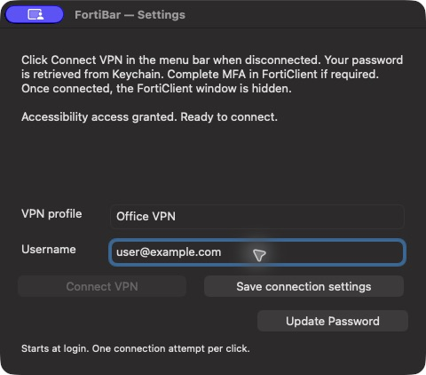

# FortiBar

**Connect to your FortiClient VPN with one click. Keep the connection, clear the screen.**

[](https://github.com/yusufani/FortiBar/actions/workflows/check.yml)


[](LICENSE)

FortiBar is a small macOS menu bar app for people who use FortiClient VPN every
day. Set it up once, then click **Connect VPN** whenever you need to connect.
FortiBar retrieves your password from macOS Keychain, fills the selected
FortiClient profile, and starts the connection. Once connected, it hides the
FortiClient window and its own menu bar button. Your VPN keeps running.



*A real screenshot of FortiBar. Example profile and username values were entered
for this screenshot without changing the saved VPN configuration.*

## A typical morning

You open your Mac and need access to your work network:

1. FortiBar is already running because it starts when you log in.
2. Your VPN is disconnected, so **Connect VPN** appears in the menu bar.
3. Click once. FortiBar uses your saved Keychain password to connect through FortiClient.
4. When the connection succeeds, the FortiClient window and the button disappear.
5. If the VPN disconnects later, the button returns within a few seconds.

For example, save a FortiClient profile called `Office VPN` and your own username.
You keep using that existing profile; FortiBar handles the repetitive login steps.
If your organization requires MFA, complete that approval in FortiClient.

## What you get

| Feature | How it helps |
| --- | --- |
| One click to connect | No need to open FortiClient and type your password each time. |
| A button only when needed | The menu bar item hides while your configured VPN is connected. |
| A clear screen after connecting | FortiClient is hidden after successful connection; the VPN stays active. |
| macOS Keychain storage | Your password stays out of source code, configuration files, and FortiBar logs. |
| Starts when you log in | FortiBar runs in the background. The source installer also restarts it after an unexpected exit. |
| Exact profile matching | Credentials are submitted only when the configured profile is selected. |
| Local operation | FortiBar sends no telemetry or network requests of its own. |

FortiBar works with your existing FortiClient installation and VPN profile.
It is a companion app, not a replacement VPN client. It connects when you click;
it does not continuously retry or automatically reconnect without your input.

## Download and install

Download [FortiBar 1.1.2 DMG](https://github.com/yusufani/FortiBar/releases/download/v1.1.2/FortiBar-1.1.2-universal.dmg),
open it, and drag **FortiBar** to **Applications**. Eject the disk image and launch
FortiBar from Applications. Follow the setup steps below.

The DMG contains a universal binary for **Apple Silicon and Intel, macOS 13+**.
Only Apple Silicon has been live tested. This is an **ad-hoc signed, non-notarized
preview**: macOS may show an unidentified-developer warning. Check the source and
the release's `SHA256SUMS.txt` before deciding whether to allow it.

FortiBar requests startup at login when launched from Applications. If macOS
requires approval, enable it under **System Settings → General → Login Items**.

## Build from source

### Requirements

- macOS 13 or later.
- FortiClient at `/Applications/FortiClient.app`, with a working VPN profile.
- Apple's Swift command line tools, Python 3, and Git.
- Accessibility permission for FortiBar, so it can operate the FortiClient login fields.

The initial live test used **English FortiClient 7.4.3 on Apple Silicon**.
The FortiBar interface is entirely English. Other FortiClient versions, languages,
and Mac architectures have not been live verified.

### Build and launch

```sh
git clone https://github.com/yusufani/FortiBar.git
cd FortiBar
./test.sh
./build.sh
./install.sh
```

The installer places the app in `~/Applications/FortiBar.app` and registers it to
start at login. It refuses to overwrite an existing installation.

### Set up once

1. Open **FortiBar** from your Applications folder.
2. Enter the **exact VPN profile name** shown in FortiClient and your username.
3. Click **Save connection settings**.
4. Click **Update Password** to save your password in macOS Keychain.
5. Allow FortiBar under **System Settings → Privacy & Security → Accessibility**.
6. Keep your configured profile selected in FortiClient, then click **Connect VPN**.

FortiClient's VPN permissions, certificates, and server configuration must already
be set up. FortiBar does not bypass MFA or certificate warnings.

## Everyday controls

| Situation | What to do |
| --- | --- |
| VPN is disconnected | Click **Connect VPN** in the menu bar. |
| You need settings while connected | Open FortiBar again from Applications; the button is hidden. |
| Your password changes | Open settings and choose **Update Password**. |
| Another VPN profile is selected | Select the configured profile in FortiClient before connecting. |
| You want to quit for this login session | Right-click the menu bar item and choose **Quit FortiBar**. |
| MFA or login fails | Check FortiClient. FortiBar makes one attempt per click to avoid repeated failed logins. |

## Privacy and security

- Passwords are stored as generic-password items in the macOS login Keychain,
  with `kSecAttrAccessibleWhenUnlockedThisDeviceOnly`. No password is compiled
  into the app, written to its configuration, or logged by FortiBar.
- During a connection, the password necessarily exists temporarily in process
  memory and is submitted to FortiClient's secure password field. Swift strings
  do not provide a guaranteed memory wipe. FortiClient and the VPN server handle
  authentication and their own logging.
- Profile name and username are local settings at
  `~/Library/Application Support/FortiBar/config.json`. This file is restricted
  to the current user and is never included in the repository.
- Accessibility is a broad macOS permission. The implementation targets only
  the FortiClient bundle identifier; review the source before granting access.
- FortiBar does not bypass MFA, certificate warnings, or password-reset prompts.
  It submits one connection attempt per click; it does not continuously retry.
- This is reviewed source code, not an independent security audit or a
  notarized installer. The downloadable DMG is an ad-hoc signed preview.

## Known limitations

The local build is ad-hoc signed. Rebuilding can invalidate Accessibility or
Keychain authorization. After an update, restart FortiBar and renew its
Accessibility entry if the running app reports no access. Check the app's
settings window or local `status.json`; a command launched from a privileged
terminal may report a different permission state.

FortiBar reads the actual FortiClient status window, including windows omitted
from the hidden application's normal Accessibility children. A leftover tunnel
IP is never treated as proof that the VPN is connected. If the window cannot be
read, FortiBar shows **Check VPN** so you can open FortiClient and inspect it.
No network requests or telemetry are sent by FortiBar itself.

## Remove automatic startup

For a DMG installation, remove or disable FortiBar under **System Settings →
General → Login Items**. For a source installation, unload its LaunchAgent:

```sh
launchctl bootout "gui/$(id -u)/com.fortibar.app"
```

Then move `~/Library/LaunchAgents/com.fortibar.app.plist` and
`~/Applications/FortiBar.app` to Trash. Saved credentials remain in Keychain
until you remove the relevant `com.fortibar.app.vpn` item with Keychain Access.

## Validation

`test.sh` checks exact profile-name parsing, valid IPv4 addresses, malformed
addresses, and disconnected screens. Build and signature verification are also
performed locally. Test VPN changes only when an interruption is acceptable;
for example, disconnecting can terminate SSH or remote desktop sessions.

The initial live check disconnected an existing VPN, connected through FortiBar
using a Keychain credential, observed FortiClient's connected screen, and then
verified that FortiClient was hidden while the tunnel remained active. The
running FortiBar process reported Accessibility access granted and its menu bar
item hidden. Local source and compiled-app scanning found no supplied password
or personal VPN profile details. These checks do not constitute an independent
security audit.

## License

[MIT](LICENSE). FortiBar is an independent project and is not affiliated with Fortinet.
